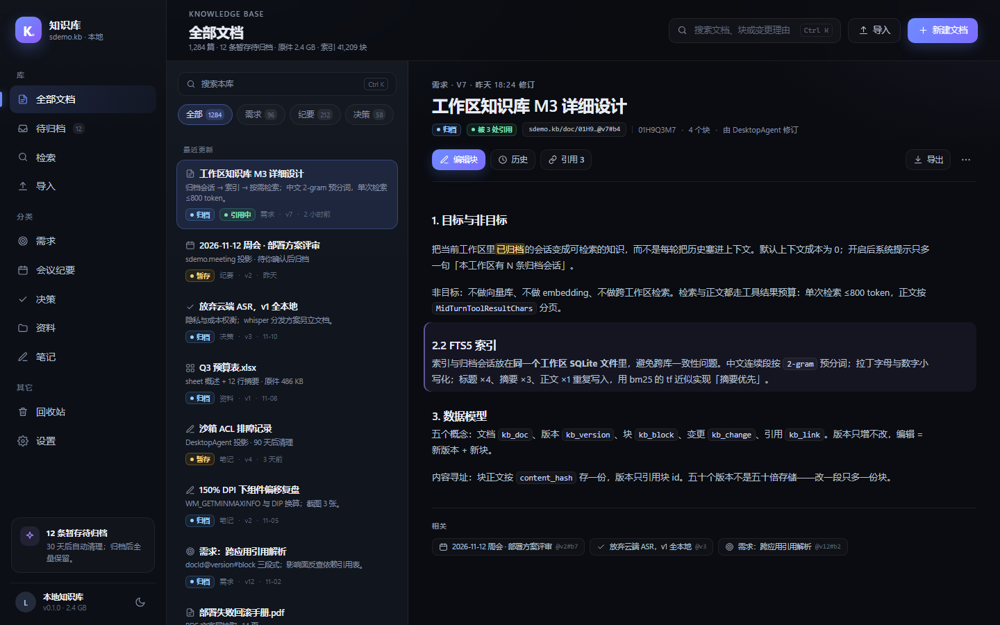
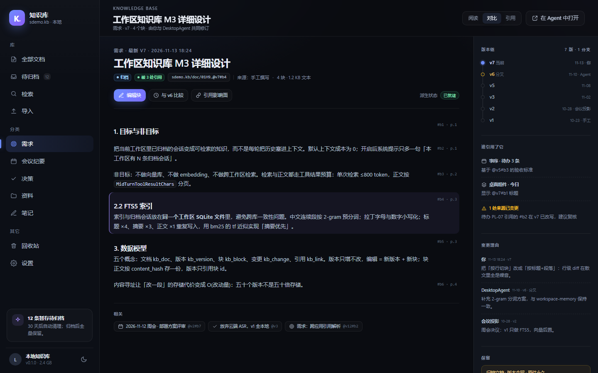
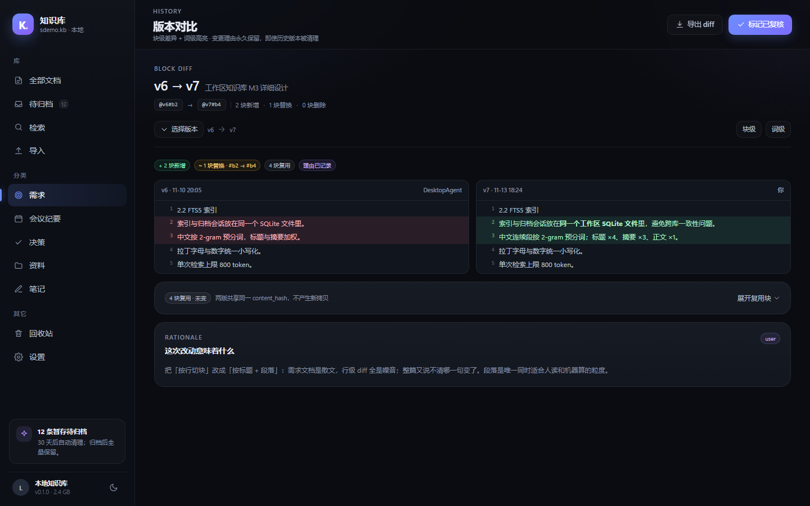
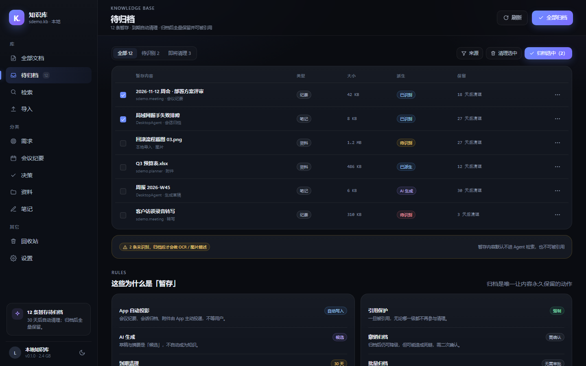
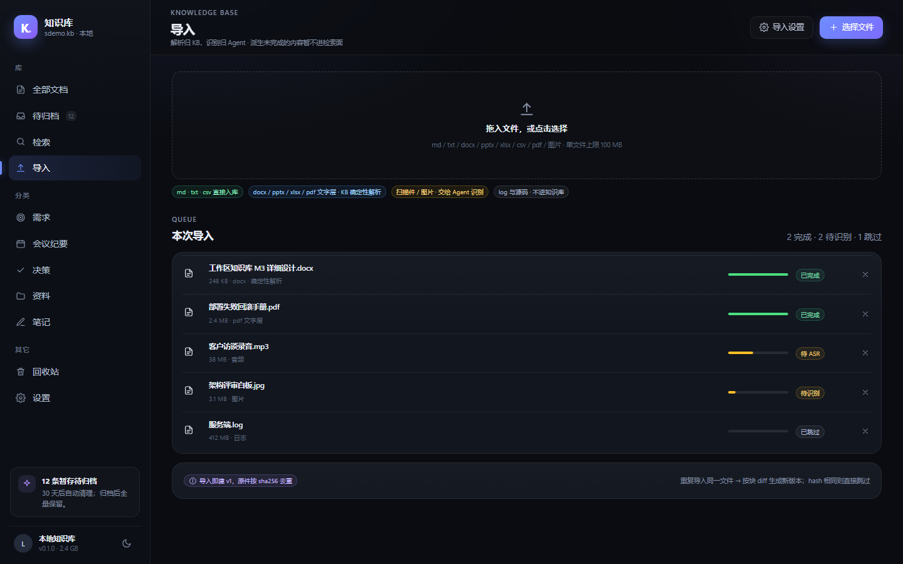
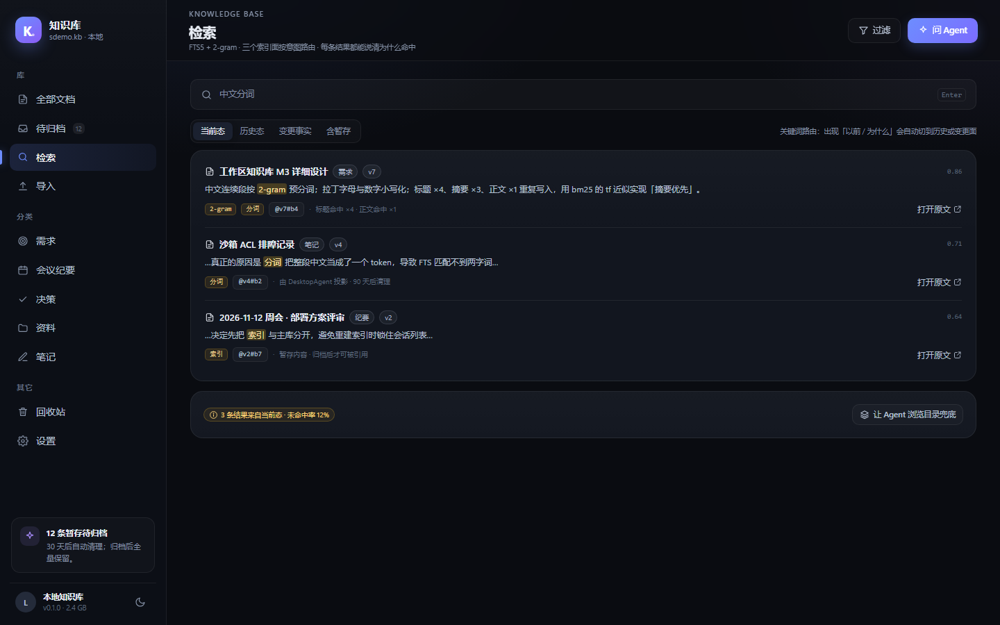
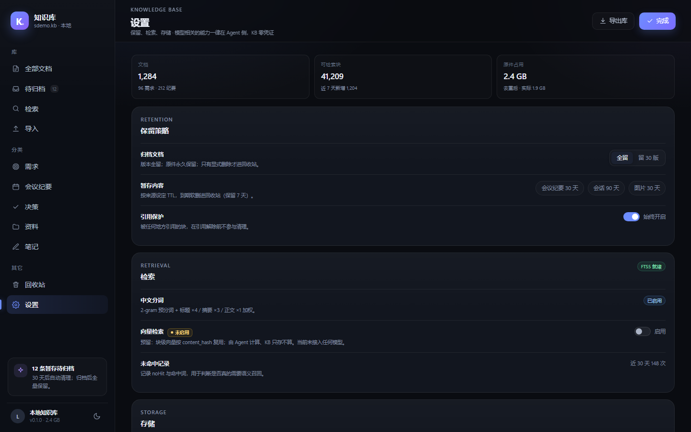

# sdemo.kb 界面设计

> 状态：**设计提案，待拍板**（2026-11-14）
> 配套：[kb-design.md](kb-design.md)（完整设计）· [ui-mockups/](ui-mockups/)（可打开的原型）
> 依赖：[SDemo.Shared 设计系统](../../../Shared/UI/SDemo.UI.Blazor/wwwroot/css/sdemo-ui.css)

---

## 1. 设计目标

| 目标 | 做法 |
| --- | --- |
| 长得像同一家的产品 | 只用 `sdemo-ui.css` 的 token 与组件；不新增颜色，不 fork 样式 |
| 桌面窗口优先 | 默认 1180×740；信息密度按桌面调，不做营销页留白 |
| 让"保留等级"随时可见 | 每个列表项、每条结果都带 `归档 / 暂存` 徽标 |
| 让"为什么"可追溯 | 变更理由常驻右栏，不藏在折叠面板里 |
| 危险动作可回退 | 删除/撤销归档一律进回收站 + 二次确认 |

**不做**：不做移动端、不做富文本 WYSIWYG（编辑就是块级编辑）、不做图谱可视化。

---

## 2. 信息架构

```
知识库
├─ 库
│  ├─ 全部文档
│  ├─ 待归档        ← 红点：12
│  ├─ 检索
│  └─ 导入
├─ 分类            ← kind 白名单：需求 / 会议纪要 / 决策 / 资料 / 笔记
│  ├─ 需求
│  ├─ 会议纪要
│  ├─ 决策
│  ├─ 资料
│  └─ 笔记
└─ 其它
   ├─ 回收站
   └─ 设置
```

侧栏底部常驻两块：**暂存提醒卡**（"12 条待归档，30 天后清理"）与 **存储足迹**（版本、体积、主题切换）。

分类是 `kind` 的投影，不是用户自建文件夹。**用户可以改标签，不能改 kind**——kind 决定默认保留策略与检索面。

---

## 3. 屏幕清单

| # | 屏幕 | 作用 | 原型 |
| --- | --- | --- | --- |
| 01 | 全部文档 | 主工作台：列表 + 阅读 | [图](ui-mockups/01-library.png) · [HTML](ui-mockups/01-library.html) |
| 01L | 浅色主题 | 同一屏的浅色形态 | [图](ui-mockups/01-library-light.png) |
| 02 | 文档详情 | 块阅读 + 版本链 + 引用 + 理由 | [图](ui-mockups/02-document.png) · [HTML](ui-mockups/02-document.html) |
| 03 | 版本对比 | 块级 diff + 词级高亮 + rationale | [图](ui-mockups/03-diff.png) · [HTML](ui-mockups/03-diff.html) |
| 04 | 待归档收件箱 | staging 的批量归档 / 清理 | [图](ui-mockups/04-inbox.png) · [HTML](ui-mockups/04-inbox.html) |
| 05 | 导入 | 拖入、队列、派生状态 | [图](ui-mockups/05-import.png) · [HTML](ui-mockups/05-import.html) |
| 06 | 检索 | 四个索引面 + 命中理由 | [图](ui-mockups/06-search.png) · [HTML](ui-mockups/06-search.html) |
| 07 | 设置 | 保留 / 检索 / 存储 | [图](ui-mockups/07-settings.png) · [HTML](ui-mockups/07-settings.html) |

原型为静态 HTML，可直接在浏览器打开；`build.py` 改完重跑即可。尺寸按 1440×900 渲染。

---

## 4. 逐屏说明

### 01 全部文档



| 区域 | 内容 |
| --- | --- |
| 列表列（348px） | 库内搜索、kind 过滤 chip、最近更新列表 |
| 列表项 | 标题、两行摘要、`归档 / 暂存` 徽标、kind、版本、时间 |
| 阅读区 | 文档头（类型 / 版本 / 保留 / 引用数 / URI）+ 工具条 + 块正文 |
| 文档尾 | "相关"引用 chip，点开跳对应块 |

关键点：

- **没有独立的"详情页"路由**：列表选中即在右侧展开，减少一次跳转。
- 列表项的徽标是**第一眼可见**的保留等级，不靠颜色区分种类。
- 块右侧的 `#b4 · p.3` 是 anchor 提示，hover 才显示（阅读时不干扰，核对引用时立刻出现）。

### 02 文档详情



右栏三块，按"你会问的问题"排序：

1. **版本链**（竖排时间线）：当前版本高亮，分叉版本单独一行标"分叉"，并给出作者与日期。
2. **谁引用了它**：分三档显示——普通引用、显示用引用、**来源已变更（琥珀色告警）**。
3. **变更理由**：按时间倒序，每条带作者来源（你 / Agent / 会议投影）。

底部"保留"说明框常驻，回答"这份东西会不会被删"。

### 03 版本对比



- 顶部摘要 pill 先给结论：`+2 块新增 / ~1 块替换 / 4 块复用`。
- 左右分栏逐行对照，删除（红）/ 新增（绿）只标**变化的行**。
- "4 块复用 · 未变"默认折叠——内容寻址的结果，不该占屏幕。
- rationale 卡片在下方：diff 回答"改了什么"，它回答"为什么改"。

### 04 待归档收件箱



这是本次设计里最关键的**新**界面——把"归档"从弹窗变成一个可批量操作的工作台。

| 列 | 含义 |
| --- | --- |
| 暂存内容 | 标题 + 来源（`sdemo.meeting · 会议纪要`） |
| 类型 | kind |
| 大小 | 文本体积 / 原件体积 |
| 派生 | `已识别 / 待识别 / AI 生成`，直接用 `status-pill` 表达 |
| 保留 | `18 天后清理`，倒计时而非日期（用户关心的是"还剩多久"） |

底部两张卡解释规则：左边"为什么是暂存"，右边"保护与撤销"。**把策略写进界面，而不是写进帮助文档。**

### 05 导入



- 拖拽区下方直接标明**归属**：哪些是 KB 确定性解析、哪些要交给 Agent、哪些不进库。
- 队列每行给"解析中 / 待识别 / 已完成 / 已跳过 + 原因"，不给模糊的百分比。
- 底部一条常驻说明：导入即 `v1`，原件按 sha256 去重，hash 相同直接跳过。

### 06 检索



- 四个 scope 是**索引面**，不是过滤器：当前态 / 历史态 / 变更事实 / 含暂存。
- 每条结果都带 `hitTerms` chip 与 URI——**这条结果为什么被召回，必须说得清**。
- 结果下方显示来源与保留等级：`暂存内容 · 归档后才可被引用`。
- 底部常驻"未命中率 + 让 Agent 浏览目录兜底"——检索失败要能降级，而不是空白页。

### 07 设置



三组：**保留策略 / 检索 / 存储**。

- 保留用分段控件与 chip，不用自由输入框。
- "向量检索"标 `未启用`，并写明"由 Agent 计算、KB 只存不算，当前未接入任何模型"——把架构约束显示给用户看。
- "未命中记录"显示累计次数，作为将来是否上语义检索的判据来源。

---

## 5. 组件与状态

### 5.1 保留徽标

| 徽标 | 语义 | token |
| --- | --- | --- |
| `● 归档` | durable，永久保留 | 蓝（info） |
| `● 暂存` | staging，有 TTL | 琥珀（warning） |
| `● 引用中` | 被引用保护 | 绿（success） |

三个徽标可同时出现（归档 + 被引用）。**颜色只表达状态，不表达种类**。

### 5.2 派生状态

| 状态 | 显示 | 检索 | 可归档 |
| --- | --- | --- | --- |
| `ready` | 已识别 | ✅ | ✅ |
| `pending` | 待识别（带转圈） | ❌ | ✅（归档后触发派生） |
| `failed` | 未识别（琥珀） | ❌ | ✅（可重试） |

`pending` 的文档**正文仍可读**，只是不进检索面。不要用"加载中"遮住内容。

### 5.3 空态与错误

| 场景 | 呈现 |
| --- | --- |
| 库为空 | 居中空态 + "导入文件"主按钮 + 一句"也可以让 Agent 帮你归档会话" |
| 检索零命中 | 不显示空白列表，显示"NoHit 说明 + 让 Agent 浏览目录" |
| KB 离线（App 侧） | App 内显示"知识库未启动，内容已暂存本地，稍后自动补传" |
| 索引损坏 | 设置页"重建索引"，不阻塞阅读（正文在库里，索引可重建） |

### 5.4 危险操作

| 操作 | 确认 | 可撤销 |
| --- | --- | --- |
| 删除文档 | 二次确认 + 影响面清单（"N 处引用"） | 回收站 7 天 |
| 撤销归档 | 二次确认（可能造成死链） | 再次归档 |
| 清理暂存 | 批量确认一次 | 回收站 7 天 |

---

## 6. 响应式与窗口

| 宽度 | 布局 |
| --- | --- |
| ≥ 1280 | 列表 348 + 阅读区 + 右栏 300（文档详情） |
| 1080–1280 | 右栏折叠成抽屉，用工具栏按钮打开 |
| < 1080 | 列表变窄到 280；kind chip 折行 |
| < 900 | 隐藏侧栏（复用设计系统断点） |

默认窗口 1180×740（与 `ThemedWindow` 一致），首屏应能同时看到列表与阅读区。

---

## 7. 键盘

| 键 | 动作 |
| --- | --- |
| `Ctrl K` | 聚焦库内搜索 |
| `↑ / ↓` | 列表内移动选中 |
| `Enter` | 打开选中文档 |
| `Ctrl Enter` | 保存当前块编辑 |
| `Esc` | 关闭弹窗 / 退出编辑 |
| `Ctrl Z` | 撤销块编辑（本地，未提交前） |

---

## 8. 界面动作与契约的对应

| 界面动作 | 契约 |
| --- | --- |
| 导入文件 | 本地解析 → `ingest(blocks, artifacts)` |
| 归档 / 撤销 | `promote(docId, retention)` |
| 删除 | `retract(docId)` |
| 编辑块 | `revise(docId, ops[], rationale, expectedVersion)` |
| 引用点击 | `resolve(uri)` → 打开文档并滚到 anchor |
| 列表徽标 | `resolve` 的批量版（`GET /v1/resolve?uris=…`，最多 50 条） |
| 检索 | `kb_search`（Agent）或内联 Core（KB 界面） |

**界面不直接调 MCP**：KB 自己的界面走进程内 Core，语义一致但少一次序列化。

---

## 9. 已知缺口

- 组件的"最小化形态"（桌面小组件）未设计：KB 是否需要 `widget` 待定，倾向**不做**（知识库不适合常驻小组件）。
- 多选批量编辑块未设计：v1 只做单块编辑。
- 版本链的图形化（真正的 DAG 图）暂不做，竖排时间线 + 分叉标记够用。

---

## 10. 如何改原型

```powershell
cd Apps\Kb\docs\ui-mockups
python build.py          # 重新生成 *.html
```

- 版式改动：改 `kb.css`（只允许用 `sdemo-ui.css` 的 token）。
- 设计 token 改动：改 `Shared` 子仓并升版本，回来同步 `sdemo-ui.css` 副本。
- 截图命令见 [ui-mockups/README.md](ui-mockups/README.md)（Chrome headless，1440×900）。
